# Web Store – Clothing Store with RESTful Web Services

A full-stack web store for clothing products. All functionality is exposed through RESTful APIs
(FastAPI), stored in a relational database (PostgreSQL) and consumed by a React front-end.

## Technologies
| Layer | Technology |
|---|---|
| Database | PostgreSQL 18 |
| Back-end | Python 3, FastAPI, SQLAlchemy, JWT (PyJWT), bcrypt |
| Front-end | React (Vite) |
| API testing | Postman, pytest |
| API docs | Swagger UI (auto-generated) – `http://localhost:8000/docs` |

## Project structure
```
Webstore/
├── database/schema.sql          # tables, views (reports), seed data
├── backend/
│   ├── app/
│   │   ├── main.py              # FastAPI app, CORS, routers
│   │   ├── database.py          # DB connection
│   │   ├── models.py            # ORM models
│   │   ├── schemas.py           # request validation (Pydantic)
│   │   ├── auth.py              # JWT authentication + role-based access
│   │   ├── services.py          # real-time stock, discounts
│   │   └── routers/             # auth, users, products, lookups, clients, orders, reports
│   ├── tests/test_api.py        # automated tests
│   ├── create_admin.py          # creates test users
│   ├── requirements.txt
│   └── .env.example
├── frontend/                    # React app
├── docs/                        # ERD diagram and screenshots
└── postman_collection.json      # Postman collection with all requests
```

## Database design
Tables:
- **roles, users**: users with roles `admin`, `advanced`, `simple`
- **genders, categories, brands, sizes, colors**: lookup tables
- **products**: name, description, price, initial_quantity, and FKs to gender/category/brand/color/size
- **discounts**: percentage discounts per product, with start/end dates
- **clients**: customer information
- **orders, order_items**: orders with status (`pending`, `confirmed`, `shipped`, `delivered`, `cancelled`) and ordered products
- **Views for reports**: `daily_earnings`, `monthly_earnings`, `top_selling_products`

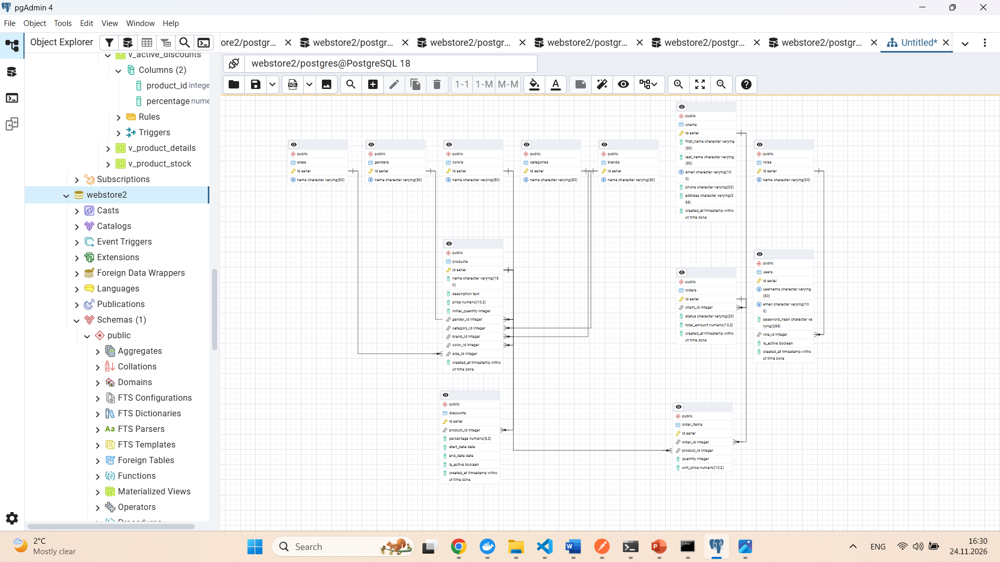

**Real-time quantity** = `initial_quantity − SUM(order_items.quantity)` for orders with status
`confirmed`, `shipped` or `delivered`.

## Setup

### 1. Database
1. Create a database in PostgreSQL (e.g. `webstore`).
2. Run `database/schema.sql` in pgAdmin (Query Tool) or with:
   ```bash
   psql -U postgres -d webstore -f database/schema.sql
   ```

### 2. Back-end
```bash
cd backend
python -m venv venv
venv\Scripts\activate          # Windows  (Mac/Linux: source venv/bin/activate)
pip install -r requirements.txt
copy .env.example .env         # then edit DATABASE_URL with your password
python create_admin.py
uvicorn app.main:app --reload
```
API: `http://localhost:8000` | Docs: `http://localhost:8000/docs`

### 3. Front-end
```bash
cd frontend
npm install
npm run dev
```
App: `http://localhost:5173`

### Test users
| Username | Password | Role |
|---|---|---|
| admin | admin123 | Admin |
| advanced | advanced123 | Advanced user |
| simple | simple123 | Simple user |

## Roles and permissions
| Action | Admin | Advanced | Simple | Public |
|---|:-:|:-:|:-:|:-:|
| View / search products, check quantity | ✅ | ✅ | ✅ | ✅ |
| Create / edit products, update stock | ✅ | ✅ | ✅ | |
| Delete products | ✅ | ✅ | | |
| Apply discounts | ✅ | | | |
| Manage categories, brands, sizes, colors, genders | ✅ | ✅ | | |
| Place orders | ✅ | ✅ | ✅ | ✅ |
| View orders, update order status | ✅ | ✅ | | |
| Reports | ✅ | ✅ | | |
| Manage users | ✅ | | | |

Authentication: `POST /api/auth/login` returns a JWT token, which is sent as
`Authorization: Bearer <token>`. Tokens expire after 2 hours.

## API documentation
Base URL: `http://localhost:8000/api`

### Authentication
| Method | Endpoint | Description |
|---|---|---|
| POST | `/auth/login` | Login, returns token. Body: `{"username":"admin","password":"admin123"}` |
| GET | `/auth/me` | Current user |

### Products
| Method | Endpoint | Description |
|---|---|---|
| GET | `/products` | All products (with final price and current stock) |
| GET | `/products/search` | Advanced search (see below) |
| GET | `/products/{id}` | One product |
| GET | `/products/{id}/quantity` | Real-time stock |
| POST | `/products` | Create product |
| PUT | `/products/{id}` | Update product |
| DELETE | `/products/{id}` | Delete product |
| PATCH | `/products/{id}/stock` | Update stock. Body: `{"initial_quantity":150}` |
| GET | `/products/{id}/discounts` | List discounts |
| POST | `/products/{id}/discounts` | Add discount. Body: `{"percentage":15,"start_date":"2026-11-23","end_date":"2026-12-31"}` |
| DELETE | `/products/{id}/discounts/{discount_id}` | Remove discount |

Example product body:
```json
{"name":"Nike Hoodie","description":"Cotton hoodie","price":55,"initial_quantity":20,
 "gender_id":1,"category_id":3,"brand_id":1,"color_id":2,"size_id":2}
```

### Advanced search
`GET /products/search` – all filters are optional and can be combined:

| Parameter | Example |
|---|---|
| `q` | name contains text |
| `gender` | `men`, `women`, `children` |
| `category` | `jackets` |
| `brand` | `tommy_hilfiger` |
| `size` | `M` |
| `color` | `red` |
| `price_min`, `price_max` | `20`, `100` |
| `availability` | `in_stock`, `out_of_stock` |

Example:
`GET /api/products/search?gender=women&brand=tommy_hilfiger&size=M&color=red&price_min=20&price_max=100`

### Real-time quantity
`GET /api/products/1/quantity`
```json
{"product_id":1,"name":"Nike T-Shirt","initial_quantity":100,"sold_quantity":25,"current_quantity":75}
```

### Lookup tables
Same endpoints for `genders`, `categories`, `brands`, `sizes`, `colors`:

| Method | Endpoint | Body |
|---|---|---|
| GET | `/categories` | – |
| POST | `/categories` | `{"name":"Shoes"}` |
| PUT | `/categories/{id}` | `{"name":"Sneakers"}` |
| DELETE | `/categories/{id}` | – |

### Clients
| Method | Endpoint | Description |
|---|---|---|
| POST | `/clients` | Create client (returns existing one if email exists) |
| GET | `/clients` | List clients |
| GET / PUT / DELETE | `/clients/{id}` | One client |

### Orders
| Method | Endpoint | Description |
|---|---|---|
| POST | `/orders` | Place order. Body: `{"client_id":1,"items":[{"product_id":1,"quantity":2}]}` |
| GET | `/orders?status=pending` | List orders (optional status filter) |
| GET | `/orders/{id}` | One order |
| PATCH | `/orders/{id}/status` | Update status. Body: `{"status":"confirmed"}` |

Stock is checked when an order is placed and again when it is confirmed.
The price includes any active discount.

### Reports
| Method | Endpoint | Description |
|---|---|---|
| GET | `/reports/daily-earnings?start=2026-11-01&end=2026-11-30` | Daily earnings |
| GET | `/reports/monthly-earnings` | Monthly earnings |
| GET | `/reports/top-products?limit=5` | Top-selling products |

### Users (admin only)
| Method | Endpoint | Body |
|---|---|---|
| GET | `/users` | – |
| POST | `/users` | `{"username":"test","email":"test@store.com","password":"test123","role":"simple"}` |
| PUT | `/users/{id}` | `{"role":"advanced","is_active":true}` |
| DELETE | `/users/{id}` | – |

### Status codes
`200` OK · `201` Created · `204` Deleted · `400` Invalid data / not enough stock ·
`401` Not logged in · `403` No permission · `404` Not found · `409` Duplicate or in use

## Tests
**Automated tests** (from the `backend` folder):
```bash
python -m pytest -q
```
They cover login, search, real-time quantity and role-based access to reports.

**Postman**: import `postman_collection.json`, run **Login** first (the token is saved
automatically), then any other request.

## Screenshots

### Shop – filter by gender
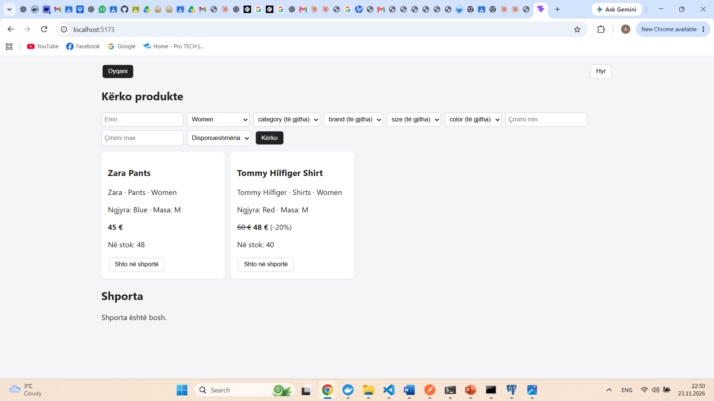

### Advanced search (gender + category + size)
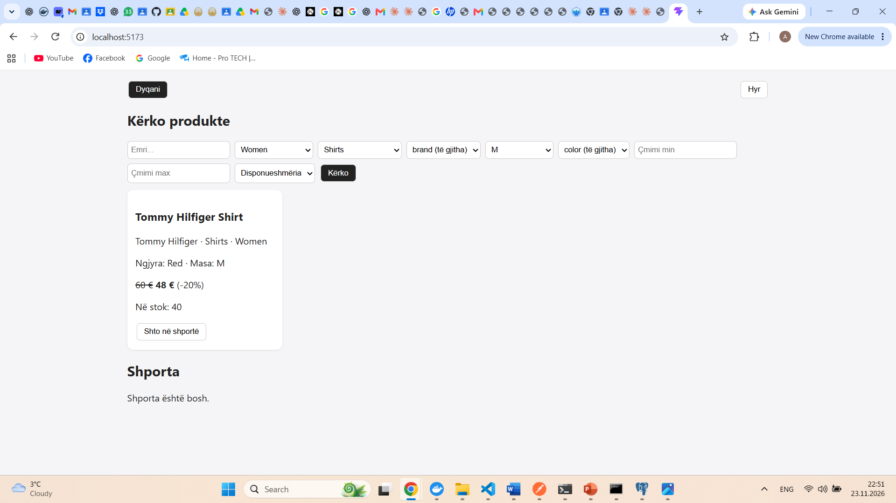

### Add product
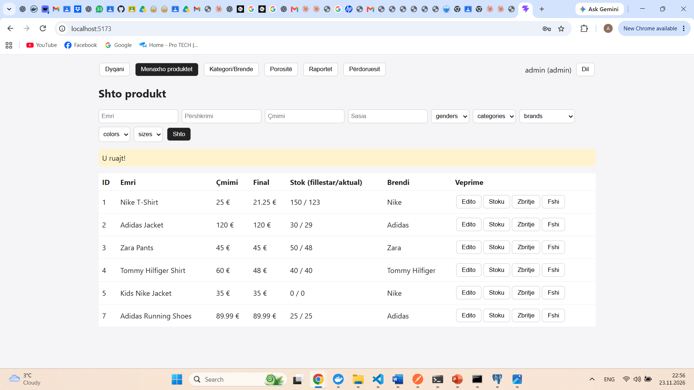

### Edit product


### Discount and stock update
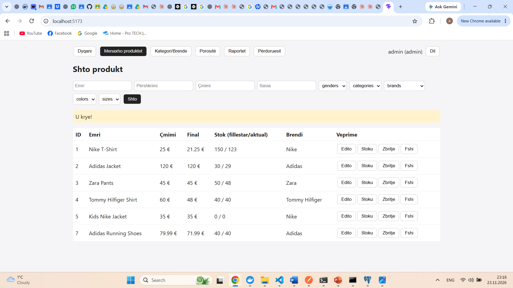

### Orders – status management
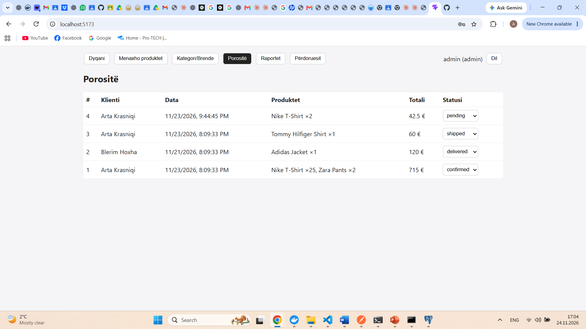

### Reports – daily/monthly earnings and top products
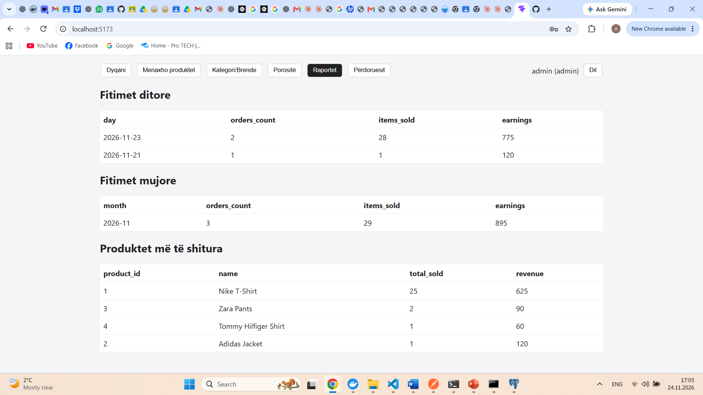

### Real-time quantity API (Postman)
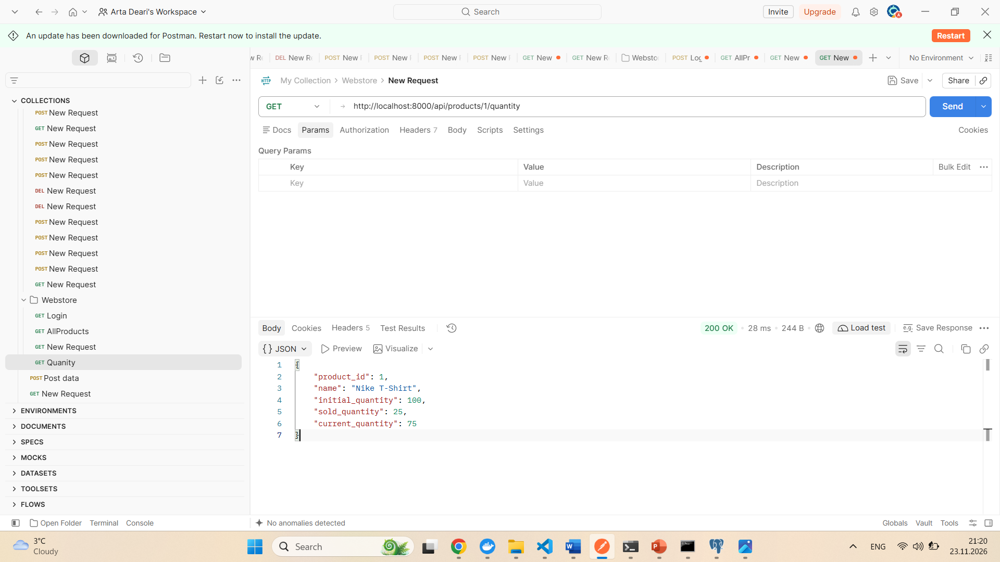

### Role-based access – simple user gets 403 on reports
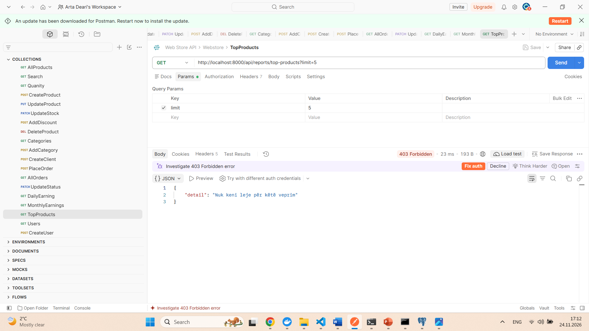

### User management (admin)
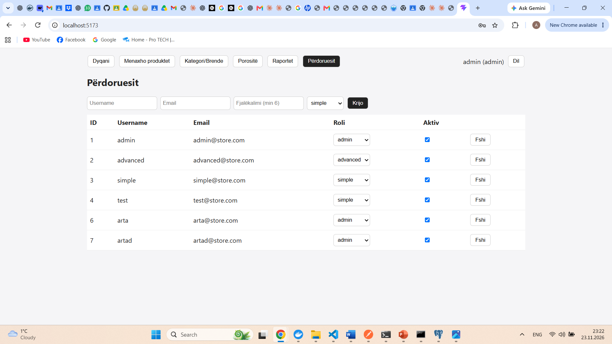

### Swagger API documentation
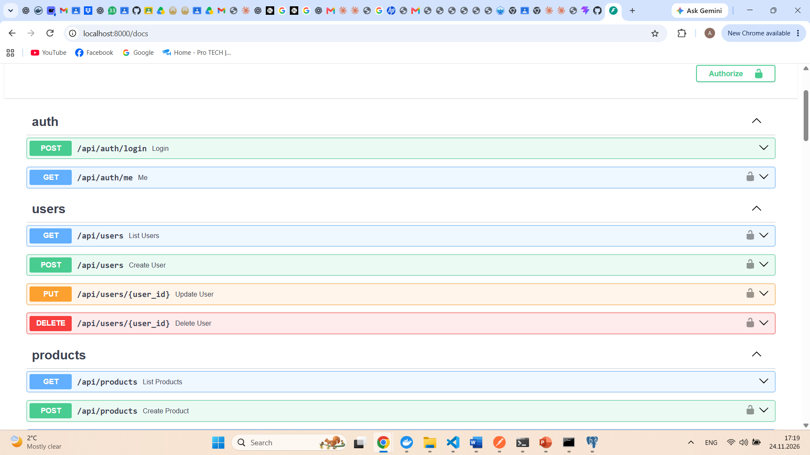